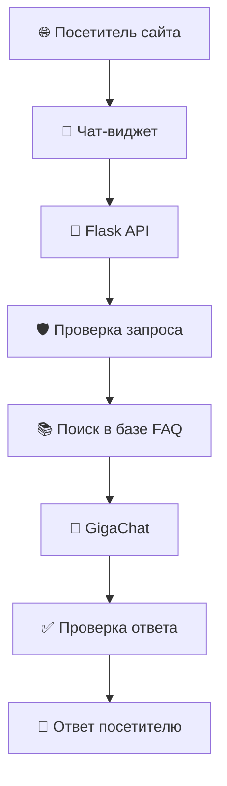
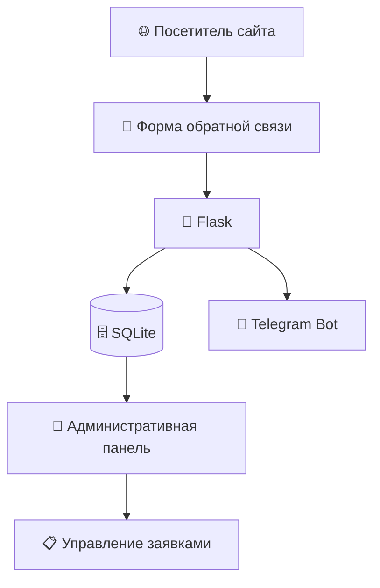

<div align="center">

# 🚀 AIGolubev

### AI Solutions · Automation · Python Development

**Персональный сайт AI-разработчика с FAQ-ассистентом и системой обработки клиентских заявок**


**Статус:** опубликован и работает · **Размещение:** Beget · **HTTPS:** подключён

### 🌐 [Открыть работающий сайт](https://aigolubev.ru)

</div>

---

## ✨ О проекте

**AIGolubev** — веб-приложение на Python и Flask, созданное для презентации услуг по разработке AI-решений и автоматизации бизнес-процессов.

Помимо публичного сайта-портфолио, проект включает механизм обработки клиентских обращений: от отправки формы до получения уведомления в Telegram и управления заявкой в закрытой административной панели.

Дополнительно интегрирован **FAQ-ассистент на базе GigaChat**, который помогает посетителям получать информацию об услугах и возможностях разработки.

### 🎯 Основные возможности

| 🌐 Для посетителей | 🔐 Для администратора |
|---|---|
| Информация об услугах и проектах | Защищённый вход |
| FAQ-ассистент на базе GigaChat | Просмотр всех обращений |
| Интерактивный чат-виджет | Поиск по заявкам |
| Форма обратной связи | Фильтрация по нескольким условиям |
| Проверка данных формы | Управление этапами обработки |
| Подтверждение отправки | Учёт прочитанных и непрочитанных заявок |
| Ссылки на проекты GitHub | Логирование и расчёт метрик |

---

## 🤖 FAQ-ассистент на базе GigaChat

На сайте реализован AI-ассистент для ответов на вопросы посетителей об услугах AIGolubev.

### Возможности ассистента

- Ответы через чат непосредственно на сайте.
- Интеграция с языковой моделью GigaChat.
- Работа с подготовленной базой знаний FAQ.
- Поиск релевантной информации.
- Поддержка контекста диалога.
- Проверка пользовательских запросов и сформированных ответов.
- Ограничение частоты и количества обращений.
- Контроль тематики вопросов.
- Обработка ситуаций, когда достоверный ответ отсутствует.
- Предложение связаться с разработчиком для индивидуального обсуждения задачи.

**Главный принцип:** ассистент не должен придумывать стоимость услуг, сроки разработки или неподтверждённые сведения.

Если вопрос выходит за рамки доступной информации, посетителю предлагается обратиться к разработчику.

### 🔄 Архитектура FAQ-ассистента



### 🧩 Основные компоненты

| Модуль | Назначение |
|---|---|
| `chat.py` | Обработка диалога |
| `knowledge_base.py` | Работа с базой FAQ |
| `search.py` | Поиск информации |
| `generator.py` | Генерация ответа |
| `memory.py` | Контекст диалога |
| `session_manager.py` | Управление сессиями |
| `validator.py` | Проверка ответов |
| `request_guard.py` | Проверка входящих запросов |
| `topic_guard.py` | Контроль тематики |
| `rate_limiter.py` | Ограничение частоты запросов |
| `daily_limiter.py` | Дневные ограничения |
| `sqlite_limiter.py` | Хранение данных для ограничений |
| `privacy.py` | Логика защиты данных |
| `visitor_identity.py` | Идентификация посетителя |
| `followup.py` | Обработка продолжения диалога |
| `data/faqs.json` | База знаний FAQ |

**Интерфейс ассистента:**

- `templates/faq_widget.html` — HTML-разметка.
- `static/js/faq_widget.js` — взаимодействие с пользователем.
- `static/css/style.css` — оформление.

---

## 🔄 Как работает система обработки заявок



**Типичный сценарий:**

1. Посетитель заполняет форму на сайте.
2. Flask проверяет введённые данные.
3. Заявка сохраняется в SQLite.
4. Администратор получает уведомление в Telegram.
5. Заявка появляется в административной панели.
6. Администратор меняет этап её обработки.

---

## 🗂️ Управление заявками

Каждая заявка имеет два независимых показателя.

**Статус прочтения:** «Не прочитано» / «Прочитано».

**Этап обработки:**

- 🔵 **Новая** — обращение поступило и ожидает обработки.
- 🟡 **В работе** — администратор занимается заявкой.
- 🟢 **Завершена** — обработка обращения закончена.

Панель поддерживает совместную фильтрацию по этапу обработки, признаку прочтения и текстовому запросу.

---

## 💼 Реализованные проекты

На сайте представлены три направления разработки.

### 1. AI-ассистент для работы с отзывами

Проект для обработки и анализа пользовательских отзывов с использованием искусственного интеллекта.

**Что реализовано:** обработка отзывов, формирование ответов и тестирование качества промптов.

**GitHub:** [Review AI Assistant](https://github.com/andrgol12-sys/review-ai-assistant)

### 2. AI-ассистенты для поиска в документах

Решения для поиска информации в документах и базах знаний с использованием технологий RAG.

**Что реализовано:** обработка документов, семантический поиск, Telegram-бот и оценка качества RAG.

**Проекты на GitHub:**

- [RAG Document Assistant](https://github.com/andrgol12-sys/rag-document-assistant)
- [RAG Knowledge Bot](https://github.com/andrgol12-sys/rag-knowledge-bot)
- [RAG Quality Evaluation](https://github.com/andrgol12-sys/rag-quality-evaluation)

### 3. Telegram-бот с искусственным интеллектом

Telegram-бот для взаимодействия пользователей с AI-ассистентом.

**Что реализовано:** обработка сообщений, работа с языковой моделью и дополнительные режимы взаимодействия.

**GitHub:** [AI Logistics Assistant](https://github.com/andrgol12-sys/ai-logistics-assistant)

**🌐 [Посмотреть портфолио на сайте](https://aigolubev.ru/#projects)**

---

## 🛠️ Технологический стек

| Компонент | Технология |
|---|---|
| Backend | Python, Flask |
| AI-ассистент | GigaChat, собственная логика FAQ |
| База данных | SQLite, Flask-SQLAlchemy |
| Логирование и метрики | SQLite, Python sqlite3, Flask hooks |
| Авторизация | Flask-Login, Werkzeug |
| Формы и CSRF | Flask-WTF |
| Frontend | HTML5, CSS3, JavaScript, Jinja2 |
| Уведомления | Telegram Bot API |
| Хостинг | Beget |
| Серверное окружение | Passenger |
| Контроль версий | Git, GitHub |

---

## 📁 Структура проекта

```text
aigolubev-website/
│
├── app.py                    # Маршруты и логика Flask
├── db_logger.py              # Логирование событий
├── metrics.py                # Расчёт метрик
├── models.py                 # Модели базы данных
├── forms.py                  # Формы и валидация
├── telegram_notify.py       # Telegram-уведомления
├── create_admin.py           # Создание администратора
├── update_db.py              # Вспомогательный скрипт БД
├── requirements.txt          # Зависимости
│
├── faq_assistant/
│   ├── __init__.py
│   ├── chat.py
│   ├── daily_limiter.py
│   ├── followup.py
│   ├── generator.py
│   ├── knowledge_base.py
│   ├── memory.py
│   ├── privacy.py
│   ├── rate_limiter.py
│   ├── request_guard.py
│   ├── search.py
│   ├── session_manager.py
│   ├── sqlite_limiter.py
│   ├── topic_guard.py
│   ├── validator.py
│   ├── visitor_identity.py
│   └── data/
│       └── faqs.json
│
├── templates/
│   ├── index.html
│   ├── faq_widget.html
│   ├── privacy.html
│   ├── consent.html
│   └── admin/
│       ├── login.html
│       └── dashboard.html
│
├── static/
│   ├── css/
│   │   └── style.css
│   ├── js/
│   │   └── faq_widget.js
│   ├── images/
│   │   └── logo.png
│   └── favicon.ico
│
├── test_telegram.py
├── test_contact_logging.py
├── test_contact_error.py
├── test_admin_logging.py
│
├── .gitignore
├── LICENSE
└── README.md
```

---

## ⚙️ Локальный запуск

### 1. Клонирование репозитория

```bash
git clone https://github.com/andrgol12-sys/aigolubev-website.git
cd aigolubev-website
```

### 2. Создание виртуального окружения

Для Windows PowerShell:

```powershell
python -m venv .venv
.\.venv\Scripts\Activate.ps1
```

### 3. Установка зависимостей

```powershell
pip install -r requirements.txt
```

### 4. Конфигурация

Перед запуском необходимо настроить переменные окружения:

- Секретный ключ Flask.
- Параметры базы данных.
- Настройки Telegram-уведомлений.
- Параметры подключения к GigaChat.

Конкретные имена переменных зависят от конфигурации приложения.

Файл `.env` не публикуется в GitHub.

### 5. Создание администратора

```powershell
python create_admin.py
```

### 6. Запуск приложения

```powershell
python app.py
```

**Сайт:** http://127.0.0.1:5000/

**Административная панель:** http://127.0.0.1:5000/admin

Для полноценной работы FAQ-ассистента необходимы действующие настройки доступа к GigaChat.

---

## 📊 Логирование и метрики

В проекте реализована система журналирования событий и расчёта метрик работы сайта на Python и SQLite.

### Логирование

Модуль `db_logger.py` сохраняет технические события в базу `instance/logs.db`.

Регистрируются:

- HTTP-запросы, их статус и время обработки.
- Успешное создание клиентских заявок.
- Ошибки сохранения заявок.
- Успешные и неудачные входы администратора.

Для событий сохраняются дата и время, уровень логирования, тип события и доступные технические параметры.

В журнал не записываются содержимое заявок, пароли и параметры URL-запросов.

### Метрики

Модуль `metrics.py` рассчитывает:

- Количество созданных заявок.
- Количество ошибок сохранения заявок.
- Количество неудачных входов администратора.
- Общее количество HTTP-запросов.
- Среднее время обработки HTTP-запросов.
- HTTP Error Rate — процент запросов с кодом ошибки 400 и выше.

Для запуска отчёта:

```powershell
python metrics.py
```

Для получения показателей за последние 7 или 30 дней:

```powershell
python -c "from metrics import get_metrics; get_metrics(days=7)"
python -c "from metrics import get_metrics; get_metrics(days=30)"
```

---

## 🔒 Безопасность

В проекте предусмотрены:

- Хеширование паролей администраторов.
- Авторизация для доступа к административной панели.
- CSRF-защита POST-форм.
- Проверка вводимых данных.
- Ограничение частоты запросов к FAQ-ассистенту.
- Проверка запросов и ответов AI-ассистента.
- Хранение конфиденциальных настроек вне Git.
- Исключение базы данных и виртуального окружения через `.gitignore`.
- Использование HTTPS на публичном сайте.
- Страницы политики обработки персональных данных и согласия на обработку персональных данных.

---

## 🌐 Развёртывание

Сайт опубликован на хостинге **Beget**.

Для запуска Flask-приложения используется Passenger.

Настроены:

- Публичный домен `aigolubev.ru`.
- HTTPS.
- Серверное окружение Python.
- Подключение к GigaChat.
- Работа FAQ-ассистента.
- Обработка заявок через форму сайта.

**Работающий сайт:** https://aigolubev.ru

Конфиденциальные настройки сервера и секретные ключи не публикуются в репозитории.

---

## 🗺️ Дальнейшее развитие

- [x] Публичный сайт и форма обратной связи.
- [x] Сохранение заявок в SQLite.
- [x] Telegram-уведомления.
- [x] Авторизация администратора.
- [x] Поиск и фильтрация заявок.
- [x] Управление этапами обработки.
- [x] Git и публичный репозиторий GitHub.
- [x] Локальное логирование событий и расчёт метрик.
- [x] Разработка FAQ-ассистента на базе GigaChat.
- [x] Интеграция чат-виджета в сайт.
- [x] Добавление проектов в портфолио.
- [x] Размещение сайта на Beget.
- [x] HTTPS и настройка домена.
- [ ] Автоматизированное резервное копирование.
- [ ] Мониторинг ошибок и доступности на сервере.
- [ ] Дополнительные автоматизированные тесты FAQ-ассистента.
- [ ] Дальнейшее тестирование мобильной версии в разных браузерах.

---

<div align="center">

### 👨‍💻 Разработчик

**AIGolubev**

Python · AI-ассистенты · Чат-боты · Автоматизация бизнес-процессов

[GitHub](https://github.com/andrgol12-sys) · [Telegram](https://t.me/Golandets1) · [Сайт](https://aigolubev.ru)

*Разработка практических AI-решений для бизнеса*

</div>
