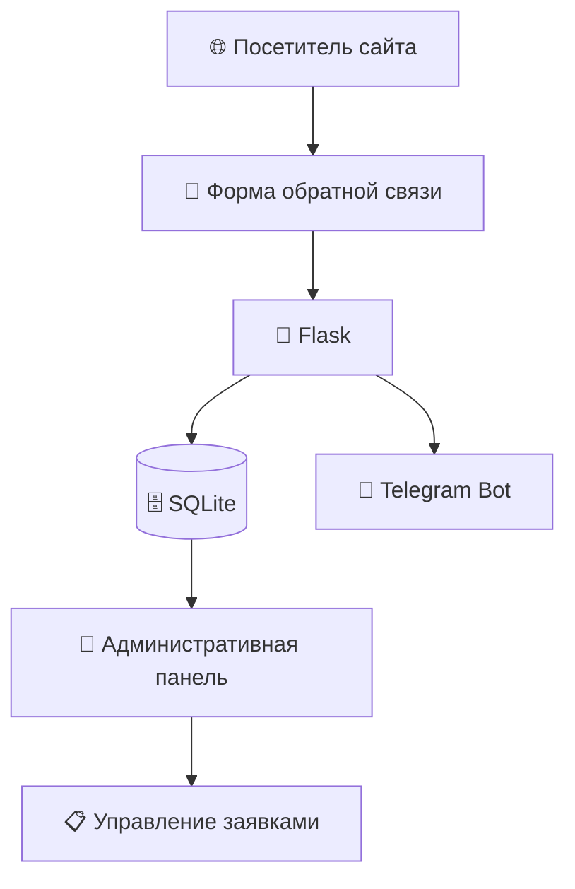

 <div align="center">

# 🚀 AIGolubev

### AI Solutions · Automation · Python Development

**Персональный сайт AI-разработчика с системой обработки клиентских заявок**


**Статус:** локальная версия разработана и протестирована · **Размещение:** в планах

</div>

---

## ✨ О проекте

**AIGolubev** — веб-приложение на Python и Flask, созданное для презентации услуг по разработке AI-решений и автоматизации бизнес-процессов.

Помимо публичного сайта, проект включает полноценный механизм обработки обращений: от отправки формы клиентом до получения уведомления в Telegram и управления заявкой в закрытой административной панели.

### 🎯 Основные возможности

| 🌐 Для посетителей | 🔐 Для администратора |
|---|---|
| Информация об услугах и проектах | Защищённый вход |
| Форма обратной связи | Просмотр всех обращений |
| Проверка данных формы | Поиск по заявкам |
| Подтверждение отправки | Фильтрация по нескольким условиям |
| — | Управление этапами обработки |
| — | Учёт прочитанных и непрочитанных заявок |

## 🔄 Как работает система



**Типичный сценарий:**

1. Посетитель заполняет форму на сайте.
2. Flask проверяет введённые данные.
3. Заявка сохраняется в SQLite.
4. Администратор получает уведомление в Telegram.
5. Заявка появляется в административной панели.
6. Администратор меняет этап её обработки.

## 🗂️ Управление заявками

Каждая заявка имеет два независимых показателя.

**Статус прочтения:** «Не прочитано» / «Прочитано».

**Этап обработки:**

- 🔵 **Новая** — обращение поступило и ожидает обработки.
- 🟡 **В работе** — администратор занимается заявкой.
- 🟢 **Завершена** — обработка обращения закончена.

Панель поддерживает совместную фильтрацию по этапу обработки, признаку прочтения и текстовому запросу.

## 🛠️ Технологический стек

| Компонент | Технология |
|---|---|
| Backend | Python, Flask |
| База данных | SQLite, Flask-SQLAlchemy |
| Авторизация | Flask-Login, Werkzeug |
| Формы и CSRF | Flask-WTF |
| Frontend | HTML5, CSS3, Jinja2 |
| Уведомления | Telegram Bot API |
| Контроль версий | Git, GitHub |

## 📁 Структура проекта

```text
aigolubev-website/
│
├── app.py                    # Маршруты и логика Flask
├── models.py                 # Модели базы данных
├── forms.py                  # Формы и валидация
├── telegram_notify.py        # Уведомления Telegram
├── create_admin.py           # Создание администратора
├── test_telegram.py          # Проверка Telegram
├── update_db.py              # Вспомогательный скрипт БД
├── requirements.txt          # Зависимости
│
├── templates/
│   ├── index.html            # Главная страница
│   └── admin/
│       ├── login.html        # Вход администратора
│       └── dashboard.html    # Управление заявками
│
├── static/
│   ├── css/style.css
│   └── images/logo.png
│
├── .gitignore
└── README.md
```

## ⚙️ Локальный запуск

### 1. Клонирование репозитория

```bash
git clone https://github.com/andrgol12-sys/aigolubev-website.git
cd aigolubev-website
```

*Для клонирования приватного репозитория требуется соответствующий доступ к GitHub.*

### 2. Создание виртуального окружения

Для Windows PowerShell:

```powershell
python -m venv .venv
.\.venv\Scripts\Activate.ps1
```

### 3. Установка зависимостей

```powershell
pip install -r requirements.txt
```

### 4. Конфигурация

Перед запуском необходимо настроить переменные окружения, включая `SECRET_KEY` и параметры Telegram-бота.

Файл `.env` не публикуется в GitHub.

### 5. Создание администратора

```powershell
python create_admin.py
```

### 6. Запуск приложения

```powershell
python app.py
```

**Сайт:** http://127.0.0.1:5000/

**Административная панель:** http://127.0.0.1:5000/admin

> Инструкция описывает локальный запуск. Перед публичным развёртыванием необходимо отдельно настроить производственный сервер и безопасность приложения.

## 🔒 Безопасность

В проекте предусмотрены:

- Хеширование паролей администраторов.
- Авторизация для доступа к административной панели.
- CSRF-защита POST-форм.
- Проверка вводимых данных.
- Хранение конфиденциальных настроек вне Git.
- Исключение базы данных и виртуального окружения через `.gitignore`.

## 🗺️ Дальнейшее развитие

- [x] Публичный сайт и форма обратной связи
- [x] Сохранение заявок в SQLite
- [x] Telegram-уведомления
- [x] Авторизация администратора
- [x] Поиск и фильтрация заявок
- [x] Управление этапами обработки
- [x] Git и приватный репозиторий GitHub
- [ ] Подготовка конфигурации для production
- [ ] Размещение сайта на сервере
- [ ] HTTPS и настройка домена
- [ ] Автоматизированное резервное копирование
- [ ] Мониторинг ошибок и доступности

---

<div align="center">

### 👨‍💻 Разработчик

**AIGolubev**

Python · AI-ассистенты · Чат-боты · Автоматизация бизнес-процессов

[GitHub](https://github.com/andrgol12-sys) · [Telegram](https://t.me/Golandets1)

*Разработка практических AI-решений для бизнеса*

</div>